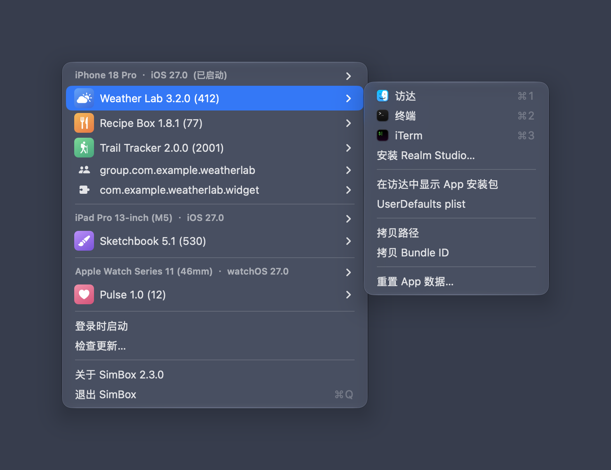
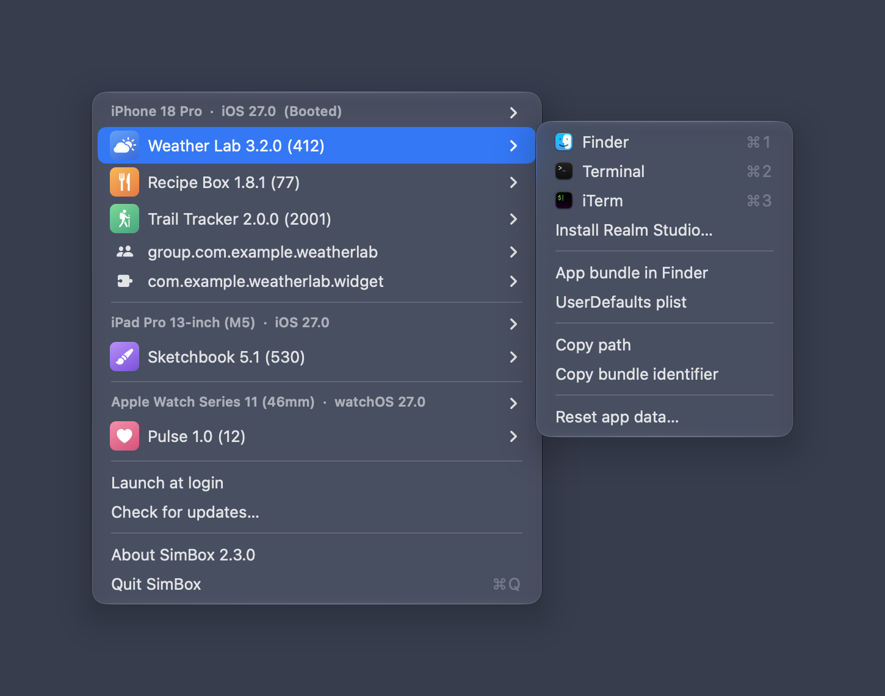

# SimBox

macOS 菜单栏工具：一键打开 iOS / iPadOS / watchOS / tvOS 模拟器里已安装 app 的沙盒目录、App Group 和 App Extension 容器。界面支持 English / 简体中文 / 繁體中文，跟随系统语言。

SimBox 面向 Xcode 27 / macOS 26+ 完全重写，最初的想法来自 [dsmelov/simsim](https://github.com/dsmelov/simsim)。

   



<details>
<summary>English / 繁體中文界面</summary>




</details>

点击菜单栏里的 SimBox 图标，按模拟器分组列出你自己安装的 app（系统 app 自动隐藏），已启动的模拟器排在最前；每个 app 的子菜单提供各种打开方式和常用操作。

## 下载安装

到 [Releases](https://github.com/wangwanjie/SimBox/releases/latest) 下载与你的 Mac 匹配的 DMG：

| Mac 类型 | 文件 |
| --- | --- |
| Apple Silicon（M 系列芯片） | `SimBox_v<版本>_arm64.dmg` |
| Intel | `SimBox_v<版本>_x86_64.dmg` |

不确定是哪种：点左上角  › 关于本机，“芯片”一栏写着 Apple M… 的选 arm64，写着 Intel 的选 x86_64。

DMG 已经过 Apple 公证，打开后把 SimBox 拖进“应用程序”即可。之后的更新通过 Sparkle 自动推送对应架构的版本。

## 功能

- 按模拟器分组列出用户安装的 app、App Group、App Extension，显示 app 图标、名称和版本号
- 已启动的模拟器排最前，其余按最近使用时间排序；超过 5 台的收进 “More Simulators” 子菜单
- 每个 app / 容器的子菜单：
  - 用 Finder / Terminal / iTerm / Commander One 打开沙盒目录（⌘1…⌘9 快捷键）
  - 在 Finder 中定位 `.app` 安装包
  - 打开 `UserDefaults` 对应的 plist
  - 复制沙盒路径、复制 bundle identifier
  - 重置 app 数据：清空 Documents / Library / tmp 内容，保留容器结构，app 下次启动即可正常读写
- 检测到 `.realm` 文件时提供 Realm Studio 快捷入口
- 模拟器标题的子菜单：在 Finder 中打开设备目录、复制 UDID
- 开机自启（SMAppService），需要授权时自动跳转到“系统设置 › 登录项”
- Sparkle 2 自动更新，Apple Silicon 与 Intel 分别推送各自的安装包
- 多语言：English / 简体中文 / 繁體中文，跟随系统语言

## 快捷键（点击 app 条目本身时）

| 修饰键 | 打开位置 |
| --- | --- |
| 无 | Finder |
| ⌥ Option | Terminal |
| ⌃ Control | Commander One（若安装） |

## 开发

要求：macOS 13+，Xcode 27。

```bash
open SimBox.xcodeproj
```

首次会解析 Sparkle SPM 包，版本锁定在 `Package.resolved`。

运行单元测试：

```bash
xcodebuild -project SimBox.xcodeproj -scheme SimBox -destination 'platform=macOS' test
```

测试用临时目录模拟 `CoreSimulator/Devices` 结构，覆盖模拟器发现与排序、app 信息解析、图标文件匹配、容器重置、按架构选择更新 feed、本地化完整性等逻辑。

## 多语言

文案集中在 [L10n.swift](SimBox/Sources/Support/L10n.swift)，key 为英文原文，翻译维护在 String Catalog [Localizable.xcstrings](SimBox/Resources/Localizable.xcstrings)（en / zh-Hans / zh-Hant）。新增文案时在 `L10n` 里加 `String(localized:)`，再到 catalog 补齐三种语言；`LocalizationTests` 会检查代码里用到的 key 是否都已翻译、占位符数量是否一致、是否有残留的废弃 key。

Debug 构建支持通过环境变量 `SIMBOX_DEVICES_ROOT` 指向任意设备目录，方便调试。

代码风格用 SwiftFormat 统一：

```bash
swiftformat SimBox SimBoxTests scripts
```

图标是脚本生成的：

```bash
swift scripts/generate_icons.swift
```

README 截图由脚本用演示数据生成（需要终端有“屏幕录制”和“辅助功能”权限）：

```bash
./scripts/screenshot/capture_readme_screenshot.sh                      # docs/screenshot.png（English）
./scripts/screenshot/capture_readme_screenshot.sh --language zh-Hans   # docs/screenshot-zh-Hans.png
./scripts/screenshot/capture_readme_screenshot.sh --language zh-Hant   # docs/screenshot-zh-Hant.png
```

## 打包 & 发布

```bash
# 归档通用包 → 用 lipo 瘦身成 arm64 / x86_64 两个 .app → 按 Sparkle 推荐顺序签名 → 生成 DMG → 公证
./scripts/build_dmg.sh --keychain-profile vanjay_mac_stapler

# 上传两个 DMG 到 GitHub Release，并生成 appcast（要先 gh auth login）
./scripts/publish_github_release.sh --notes-file path/to/notes.md
```

`build_dmg.sh` 支持 `--arch arm64` / `--arch x86_64` 只打单个架构，`--no-notarize` 跳过公证（ad-hoc 签名，仅本地测试）。

`publish_github_release.sh` 结尾会调 `scripts/generate_appcast.sh`，生成三份 feed：

| 文件 | 读取方 |
| --- | --- |
| `appcast-arm64.xml` | 2.2.0 起的 Apple Silicon 版本 |
| `appcast-x86_64.xml` | 2.2.0 起的 Intel 版本 |
| `appcast.xml` | 2.1.0 及更早的通用包：arm64 项带 `hardwareRequirements=arm64` 排在前，Intel 机器会自动落到 x86_64 项 |

app 根据编译架构把 `Info.plist` 里 `SUFeedURL` 的 `appcast.xml` 替换成对应架构的文件名。三份文件都要 commit 并 push 到默认分支。

## Sparkle 密钥

一次性生成后放在 Keychain（account: `cn.vanjay.SimBox.sparkle`）：

```bash
SPARKLE_BIN="$(find ~/Library/Developer/Xcode/DerivedData -path '*/SourcePackages/artifacts/sparkle/Sparkle/bin' -type d | sort -r | head -1)"
"$SPARKLE_BIN/generate_keys" --account cn.vanjay.SimBox.sparkle
```

对应的 public key 已写入 `SimBox/Info.plist` 的 `SUPublicEDKey`。

## 版本号

在 `SimBox.xcodeproj/project.pbxproj` 里改 `MARKETING_VERSION` 与 `CURRENT_PROJECT_VERSION`（app 和测试 target 各两处）。当前 2.3.0（build 4）。

## License

MIT，见 [LICENSE](LICENSE)。
